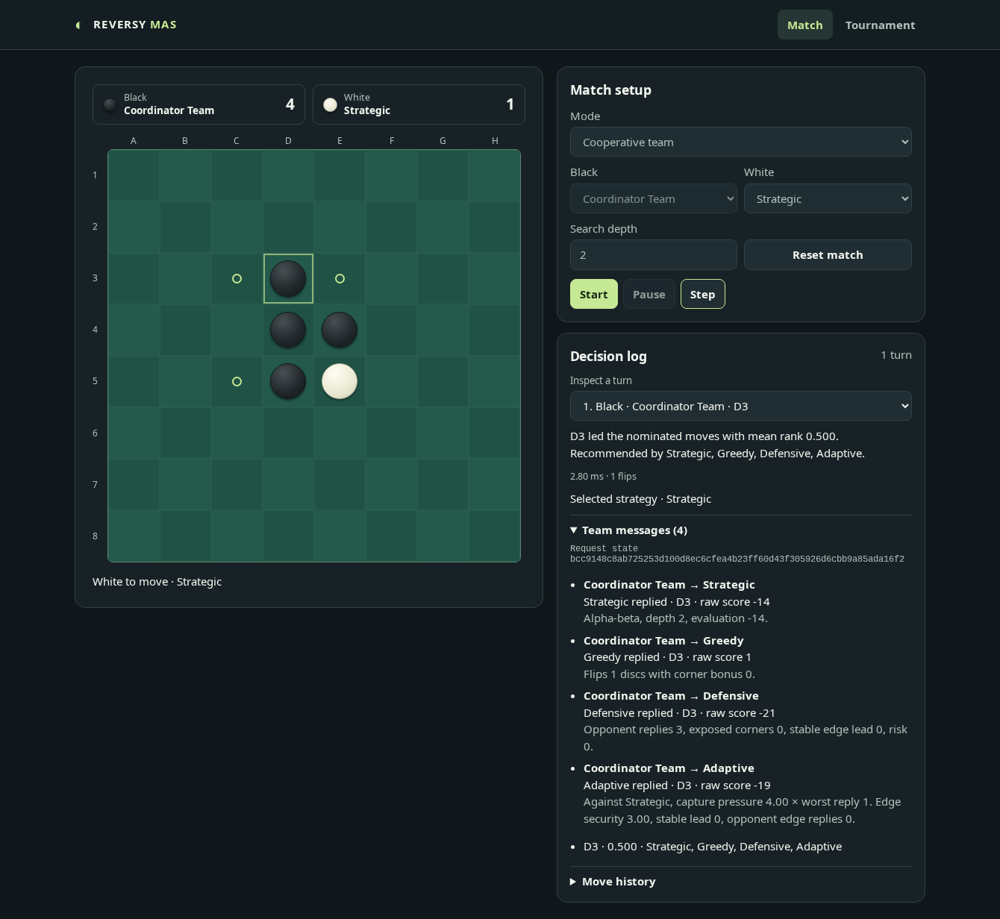

# REVERSY MAS

A Python Reversi game and multi-agent system for a university demonstration. Five player policies compete on the same rules engine. The Coordinator Team lets four separate strategies recommend moves, compares their rankings, and submits a single legal move.



## Desktop app (Windows)

Install Python 3.11 or later with Tkinter, then double-click `Run REVERSY MAS.bat`. The game opens in its own window. Choose a mode and opponent, then select **New game**. In human mode, click a highlighted square; the AI replies automatically. In agent modes, use **Start / Pause** or **Step**. The latest decision and team proposals appear beside the board.

Alternatively run `py -3 -m reversy_mas.ui.desktop` from the project folder. The game uses the Python standard library; no server or browser is needed.

## Optional browser demo

Install Python 3.11 or later and open a terminal in the project folder. The game and browser interface use the Python standard library.

```powershell
# Windows PowerShell
py -3 -m reversy_mas.ui.app
```

```bash
# macOS or Linux
python3 -m reversy_mas.ui.app
```

Open [http://127.0.0.1:8000](http://127.0.0.1:8000) in a browser. To use a different port, pass `--port 8001`. Press Ctrl+C in the terminal to stop the server.

| Mode | How to use it |
| --- | --- |
| Cooperative team | Choose an opponent and click **Reset match**. Click **Step** to see four proposals, comparable ranks, who recommended the selected move, and the shared board ID. |
| AI vs. AI | Pick a strategy for each color, reset, and click **Start** for automatic play, **Pause** to inspect, or **Step** for one turn. Both colors can use separate instances of the same agent. |
| Human vs. AI | Choose the White agent and reset. Play Black by clicking a highlighted square. Use **Step** or **Start** for the AI reply, or **Pass** when the human has no legal move. |
| Tournament | Set the seed, paired openings, and depth. Run the tournament to see win rates, decision times, individual games, coordination comparisons, and adaptive updates. |

Match settings take effect on **Reset match**. The decision log opens on the latest turn. Use **Inspect a turn** to review earlier decisions, messages, and weight changes. An in-flight turn may finish after **Pause** is pressed.

## Agents

| Agent | Decision policy |
| --- | --- |
| Strategic | Alpha-beta minimax with positional weights, mobility, corner risk, and late-game disc balance. Depth 1–5, with exact search by default at five or fewer empty squares. |
| Greedy | Maximizes immediate disc flips. The Python API offers an optional corner bonus. |
| Defensive | Restricts rival replies, penalizes exposed corners, and estimates stability from corner-connected edge discs. |
| Adaptive | Measures rival capture and edge preferences against legal alternatives. Updates two scoring weights after informative opponent moves. |
| Coordinator Team | Collects complete legal-move ballots from all four strategies. Averages normalized ranks and selects among nominated moves. |

## Architecture

`environment.py` owns the rules and turn transitions. `match.py` gives agents frozen board snapshots, submits an approved action, and returns typed outcome messages. `agents/` contains independent policies. `messages.py` defines the request, proposal, decision, and feedback records. `tournament.py` runs paired matches and calculates metrics. The local browser UI uses the same engine and policies as the command line.

The original [REVERSY](https://github.com/MasterAkbariDev/REVERSY) informed the legal-move rules, alpha-beta search, and position evaluation. [Architecture and source review](docs/architecture.md) · [Persian presentation guide](docs/university-presentation-fa.md)

## Tests and tournaments

```powershell
py -3 -m venv .venv
.\.venv\Scripts\python.exe -m pip install -r requirements.txt
.\.venv\Scripts\python.exe -m pytest -q
py -3 -m reversy_mas.tournament --seed 42 --openings 5 --depth 2 --output experiment-local.json
```

On macOS or Linux, use `python3 -m venv .venv` and `.venv/bin/python` for installation and tests. Use `python3` for the tournament command.

Opening configurations and match outcomes are deterministic for the same Python runtime and parameters. Time measurements vary by machine and run. The five-opening experiment runs 100 games. [Method and findings](docs/experiments.md) · [Raw match results](docs/experiment-results.json)

