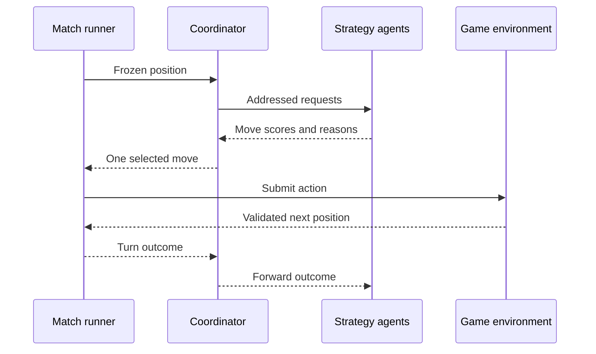

# Architecture

## Original project review

The source review used [REVERSY main at a3b018a](https://github.com/MasterAkbariDev/REVERSY/tree/a3b018a97a8abe983eb059376c050ae753bddda8). Its JavaScript engine scans eight rays for opponent discs bracketed by the current player's color. It uses the standard opening and ends when both colors lack moves. Its AI applies alpha-beta minimax with positional weights, mobility, near-corner risk and phase-dependent disc counts. The original search uses depths 3, 5, 7, and 8, with Expert used as a challenger, and an occasional random weaker pick on Easy. The game loop offers human vs. AI, human vs. human, and AI vs. AI, with scores, highlighted legal moves, passing, and a reset.

The Python implementation reconstructs the rules with precomputed rays, immutable snapshots, and a bounded move cache. It uses a revised positional matrix and deterministic depth settings for the demonstration. Search depth counts placements, so a forced pass keeps the remaining depth. Exact endgame search can therefore cross passes and still evaluate terminal positions. Each legal root move uses a full alpha-beta window so the Strategic agent can return comparable scores for its entire ballot.

## Environment and agent autonomy

A board is an immutable tuple of 64 cells in row-major order. Black is 1, White is −1, and an empty square is 0. A frozen `Position` holds the board and side to move. Its SHA-256 identifier includes the side to move, which distinguishes the states before and after a pass. The `Game` validates every move before replacing its current position. A match ends when both colors have no move, including boards with empty squares. Equal disc counts give a draw.

Each player has its own agent instance and policy. Its input is the current position and outcome feedback from earlier turns. An agent can generate hypothetical boards without access to the live game. In competitive play the active agent chooses independently. It reacts to changing legal moves, corners and mobility. If a custom agent returns an illegal move, the runner records the attempt and applies the first legal move. The environment handles forced passes without requesting an agent decision.

## Cooperation protocol

Each team member receives its own request with sender, recipient, and the same frozen position. It independently scores every legal move and sends a proposal with its identity, destination, state ID, scores, and reasons. Its nomination is its highest-scored move, with the lowest square index breaking an internal tie. The Coordinator checks routing, state ID, legal-move coverage, uniqueness, and finite scores. It records rejected messages in the decision history. When all proposals fail validation, it chooses the first legal square.

Raw score units range from flip counts to minimax evaluation points. For each candidate, a ballot assigns the fraction of alternative moves it beats and gives half credit for ties. A board with one legal move gives it rank 1. The Coordinator averages the ranks across accepted ballots and considers the moves nominated by at least one member. It chooses the greatest mean rank, then the most nominations, then the lowest square index. Means are rounded to 12 decimal places to keep numerical noise from deciding mathematical ties. The log records all endorsers of the winning move. The first member in roster order gets primary credit when several members nominate it, which influences attribution counts.

The Coordinator submits one decision for its color. The match runner sends a typed outcome containing the before and after positions, move, and flip count to both participants. A team forwards the outcome to its members. The runner records any weight changes that result.

## Adaptation

The Adaptive agent maintains two opponent-specific estimates. When the opponent chooses between moves with different capture counts, the capture signal is the chosen number of flips minus the legal mean, divided by the legal capture range. When the opponent can choose between edge and interior moves, the edge signal is the chosen edge indicator minus the legal fraction of edge moves. Both signals lie between −1 and 1.

Each informative observation updates its estimate using `estimate = 0.7 * old + 0.3 * signal`. The scoring weights are `4 + 3 * capture_estimate` and `3 + 2 * edge_estimate`. A larger capture weight penalizes moves that permit a large rival capture. A larger edge weight rewards stable edge control and penalizes rival edge replies. The updates are recorded with the old weight, new weight, and triggering choice. Forced moves, passes, and the agent's own moves provide no learning signal.

Calling `start_match` with the same opponent name on a reused Adaptive instance retrieves its existing profile. A different name has a separate profile. The UI creates fresh instances on reset, and the controlled tournament uses fresh instances per fixture to eliminate transfer between comparisons. Memory lives in process. Observed adaptation can change ratings without changing the best move, and the experiment does not attribute results specifically to learning.

## Why this is a multi-agent system

Independent decision-makers perceive a shared environment and react to actions by other agents. Two autonomous participants compete for opposite goals. A cooperative side distributes evaluation across four separately implemented strategies, exchanges state-tagged messages, and coordinates one joint action. Observed opponent choices alter future evaluation in the Adaptive policy. Rule enforcement, message logs, and paired tournaments make each claim testable.
